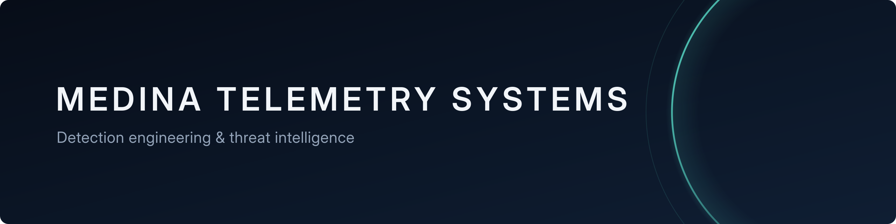

## Documented, tested detection rules for newly disclosed vulnerabilities

Medina Telemetry Systems tracks newly disclosed and actively exploited vulnerabilities every day, and turns the ones that matter into detection rules for SIEMs and network sensors. Every rule is proven against test samples and documented, so the analysts who receive its alerts know exactly what it detects, and why. The rules are free to use under the Detection Rule License.

## What we publish

| | |
|:--|:--|
| **Detection rules** | Sigma, Suricata and YARA rules, with conversions for Splunk, Microsoft Sentinel and Elastic |
| **Rule cards** | The rationale, source evidence, false-positive notes and test evidence behind each rule |
| **Advisories** | Plain-English guidance for important vulnerabilities that can't yet support a reliable rule |

Everything is in [**detections-public**](https://github.com/Medina-Telemetry-Systems/detections-public).

## Our standard

Every rule we publish includes:

- **Rationale:** what the rule detects, and why that part of the attack is the harmful part
- **Source evidence:** the vendor advisory, patch or proof of concept it is based on, quoted and linked
- **False-positive guidance,** written for the analysts who will receive the alerts
- **Test evidence:** proof that it fires on the attack and stays silent on normal activity
- **MITRE ATT&CK mapping** and a maturity status: experimental, lab-tested or stable

Rules are drafted with AI assistance, then validated by automated tests and reviewed by a person before publication. Severity is reported as the CVSS v3.1 base score.

## About

Former FBI Special Agent (counterintelligence and cyber investigations), Information System Security Specialist, and Cyber Threat Intelligence analyst, with 10 years across law enforcement, federal counterintelligence and cybersecurity. That includes numerous government contracts supporting the Intelligence Community and DoD. Specializes in turning threat intelligence and proof-of-concept exploit analysis into detection requirements and countermeasures, with a focus on Chinese and Russian state-sponsored threats.

CompTIA Security+, CySA+ and PenTest+, plus eJPT. CISSP in progress.

[LinkedIn](https://www.linkedin.com/in/uzoma-onwumere-160966273)
